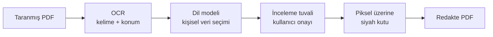

# KVKK Redact

**Taranmış PDF belgelerdeki kişisel verileri OCR + yapay zekâ ile bulup, onaydan sonra geri dönüşsüz karalayan araç.**

> Kaynak kodu gizli. Bu repo aracın ne yaptığını ve nasıl çalıştığını anlatır.

---

## Sorun

Kurumlar paylaşmak zorunda oldukları belgelerde ad-soyad, TC kimlik numarası, telefon, adres, IBAN gibi kişisel verileri KVKK gereği gizlemek zorunda. Belgeler taranmış (görüntü) olduğu için metin araması işe yaramıyor; elle karalamak ise yüzlerce belgede saatler sürüyor ve hata riski yüksek.

## Nasıl çalışıyor

1. **OCR (Tesseract)** sayfadaki her kelimeyi ve konumunu çıkarır
2. **Dil modeli** bu kelimelerden hangilerinin kişisel veri olduğunu seçer. Koordinatlar OCR'dan geldiği için model sadece "hangisi" sorusuna cevap verir
3. Kullanıcı sonucu ekranda görür, gerekirse düzeltir
4. Onaylanan alanlar sayfa görüntüsünün üzerine **siyah kutu olarak basılır**. Altındaki metin tamamen yok olur, geri getirilemez

## Üç çalışma modu

- **Tek dosya:** Yükle, tara, düzelt, indir
- **Toplu klasör:** İç içe büyük bir klasör ağacındaki tüm PDF'leri tarar, çıktıyı aynı klasör yapısında yazar. Dosyalar bilgisayardan dışarı çıkmaz. Şüpheli dosyalar inceleme kuyruğuna düşer
- **Çok kişili inceleme kuyruğu:** Yönetici dosyaları sunucuya yükler; inceleyiciler "sıradaki dosyayı al" diyerek çakışmadan paralel çalışır (her dosya tek kişiye kilitlenir)

## Teknik kararlar

- İlk sürümde yerel bir NER modeli (torch/transformers) vardı. Doğruluk yetmeyince tespiti dil modeline taşıdım; böylece ağır bağımlılıklar kalktı, imaj küçüldü, tarama hızlandı
- Redaksiyon tuvalini derleme gerektirmeyen saf JS + SVG ile kendim yazdım
- Çok kullanıcılı giriş: bcrypt + imzalı çerez

## Teknoloji

Python · Streamlit · Tesseract OCR · pdf2image · Pillow · OpenRouter · Docker

---

[bycan.dev](https://bycan.dev) · [@bycandev](https://instagram.com/bycandev) · [Tüm projelerim](https://github.com/bycandev)
