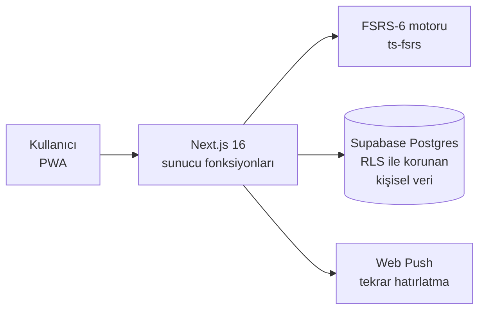

# LearnStride

**Unutmadan İngilizce kelime öğrenmek için FSRS tabanlı, Türkçe arayüzlü web uygulaması (PWA).**

> Proje geliştirme aşamasında, kaynak kodu şimdilik gizli. Bu repo ne yaptığını ve nasıl kurulduğunu anlatır.

---

## Fikir

Kelime ezberlemenin sorunu öğrenmek değil, unutmak. LearnStride her kelimeyi tam unutmak üzereyken tekrar karşına çıkarıyor. Bunun için Anki'nin de kullandığı modern aralıklı tekrar algoritması **FSRS-6**'yı kullanıyor: her kelime için "ne kadar sağlam hatırlıyorsun" ve "ne kadar zor" değerlerini tutup bir sonraki tekrar zamanını hesaplıyor.

## Özellikler

- FSRS-6 ile kişiye özel tekrar takvimi
- Telefona uygulama gibi kurulabilen PWA, anlık bildirimle tekrar hatırlatma
- Arkadaş ekleme, gizlilik ayarları ve ilerleme takibi
- Tamamen Türkçe arayüz, 21 ekranlık tasarım sistemi

## Mimari ilkeler

- **Ortak sözlük** yalnızca sunucu tarafından yazılır; **kişisel öğrenme verisi** satır düzeyinde güvenlikle (RLS) sadece sahibine açık
- Öğrenme durumu yalnızca sunucu fonksiyonlarıyla değişir, istemci doğrudan yazamaz

## Test yaklaşımı

Bu projede testi işin merkezine koydum:

- **Birim testleri** (Vitest), öğrenme modülünde %95 üzeri satır kapsamı şartı
- **Entegrasyon testleri** yerel Supabase üzerinde
- **Veritabanı testleri** (pgTAP) ile güvenlik kurallarının denetimi
- **Uçtan uca testler** (Playwright), masaüstü ve mobil görünüm
- **Simülasyon testi:** 5 farklı tohumla sentetik öğrenciler oluşturup algoritmanın davranışını eşik değerlerle kontrol eden ve rapor yazan bir senaryo

## Teknoloji

Next.js 16 · TypeScript · Tailwind 4 · Supabase · ts-fsrs · Vitest · Playwright · pgTAP · Docker · Coolify

---

[bycan.dev](https://bycan.dev) · [@bycandev](https://instagram.com/bycandev) · [Tüm projelerim](https://github.com/bycandev)
