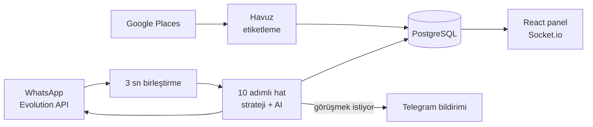

# Müşteri Bulucu Bot

**Google Haritalar'dan potansiyel müşteri bulan, WhatsApp'tan yapay zekâ ile konuşup ilgilenenleri bana devreden satış botu.**

> Kaynak kodu gizli. Bu repo projenin ne yaptığını ve nasıl kurulduğunu anlatır.

---

## Neden yaptım

NodeDine için müşteri bulma, ilk mesajı atma, takip etme ve "ilgileniyor mu?" sorusunu cevaplama işini bir sisteme devretmek için. Ben sadece gerçekten görüşmek isteyen işletmeyle konuşuyorum.

## Ne yapıyor

**1. Müşteri bulma**
- Google Places ile şehir, ilçe ve işletme türüne göre arama; puan, yorum sayısı, web sitesi ve telefon filtreleri
- Bulunanlar önce bir havuza düşer, aynı işletme ikinci kez gösterilmez
- Telefonun WhatsApp'ta kayıtlı olup olmadığını kontrol eder, web sitesinden Instagram hesabını çıkarır

**2. Konuşma**
- Gelen mesajlar 3 saniye bekletilip birleştirilir, sonra 10 adımlı bir işlem hattından geçer
- Müşterinin durumuna göre strateji değişir: ilk temas, fiyat sorusu, ikna, kapanış, takip
- Yapay zekâ her cevabın sonuna sistem etiketleri ekler: satın alma niyeti skoru (0-10), önerilen durum, öğrendiği yeni bilgi
- Sohbet içinde eksik bilgileri (işletme adı, şehir, mevcut menü sistemi) doğal sorularla tamamlar

**3. Devretme ve takip**
- Müşteri görüşmek isteyince bot susar, bana Telegram bildirimi gelir
- Zamanlayıcı: çalışma saatleri, günlük mesaj limiti, mesajlar arası 1-3 dakika rastgele bekleme, 24 saat sonra takip mesajı
- Her sabah Telegram'a özet rapor

**4. Panel**
- React ile yönetim paneli: Pano, Müşteriler, Sohbet, Arama, Ayarlar
- Socket.io ile canlı güncelleme, JWT ile giriş
- Yapay zekâ sağlayıcısı panelden seçilir: Gemini, Claude veya OpenRouter

## Akış

## Teknoloji

Node.js · Express · PostgreSQL · React · Vite · Tailwind · Zustand · React Query · Socket.io · Evolution API · Telegram Bot API · Google Places API · Gemini / Claude / OpenRouter

---

[bycan.dev](https://bycan.dev) · [@bycandev](https://instagram.com/bycandev) · [Tüm projelerim](https://github.com/bycandev)
