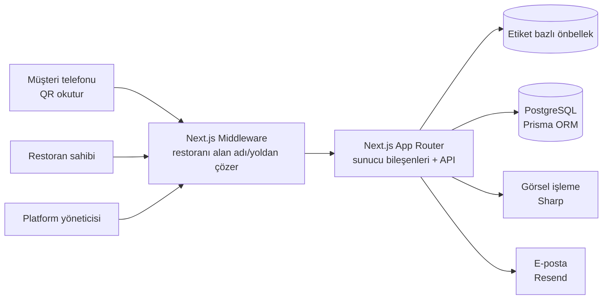

# NodeDine

**Restoranlar için QR menü, restoran sayfası ve yönetim paneli. Tek uygulama, çok restoran.**

🌐 [nodedine.com](https://nodedine.com)

> Kaynak kodu ticari bir ürün olduğu için gizli. Bu repo, ürünün ne yaptığını ve nasıl kurulduğunu anlatır.

---

## Neden yaptım

Ailemizin restoranı, kâğıt menüde fiyat değişiklik tarihi olmadığı için Ticaret Bakanlığı denetiminde uyarı aldı. Her fiyat değişikliğinde menüyü yeniden bastırmak hem pahalı hem yavaştı. Önce sadece o restoran için bir QR menü yaptım. Çevredeki işletmeler de isteyince bunu, her restoranın kendi panelini yönettiği bir SaaS ürününe dönüştürdüm.

## Ne yapıyor

Üç ayrı kullanıcı yüzü tek uygulamada çalışıyor:

| Kim | Nerede | Ne yapıyor |
|---|---|---|
| Müşteri | `nodedine.com/{restoran}` veya restoranın kendi alan adı | Telefondan QR okutup menüyü ve restoran sayfasını görür |
| Restoran sahibi | `/{restoran}/panel` | Kategori, ürün, fiyat, fotoğraf ve profil yönetimi |
| Platform yöneticisi (ben) | yönetici paneli | Tüm işletmeler ve abonelik planları |

**Öne çıkan özellikler**
- Çok kiracılı (multi-tenant) mimari: her istek alan adından veya yoldan çözülüp doğru restorana yönlendiriliyor
- Restoranın kendi alan adını bağlayabilmesi (custom domain)
- Değiştirilebilir menü temaları, her tema ayrı yükleniyor
- Sürükle-bırak ile kategori ve ürün sıralama
- Logolu, stilize QR kod üretimi
- Görsel yüklemede MIME + magic byte doğrulama, otomatik optimizasyon (Sharp)
- Etiket bazlı önbellek: fiyat değişince sadece o restoranın menüsü yenileniyor
- Sayfa görüntüleme ve tekil ziyaretçi analitiği, grafiklerle panelde
- Kayıt, e-posta doğrulama ve şifre sıfırlama akışları

## Mimari

## Teknoloji

| Katman | Kullanılan |
|---|---|
| Framework | Next.js 16 (App Router), React 19, TypeScript |
| Arayüz | Tailwind CSS 4, Framer Motion, dnd-kit, Recharts |
| Veri | PostgreSQL 16, Prisma ORM, Zod doğrulama |
| Test | Vitest (birim + entegrasyon) |
| Yayın | Docker (3 aşamalı build, standalone çıktı), Coolify, kendi sunucum |

## Rakamlarla

- ~400 TypeScript/TSX dosyası, 50'den fazla veritabanı migration'ı
- Gerçek restoranlarda kullanılıyor (ilk müşteri: ailemizin restoranı)

---

[bycan.dev](https://bycan.dev) · [@bycandev](https://instagram.com/bycandev) · [Tüm projelerim](https://github.com/bycandev)
