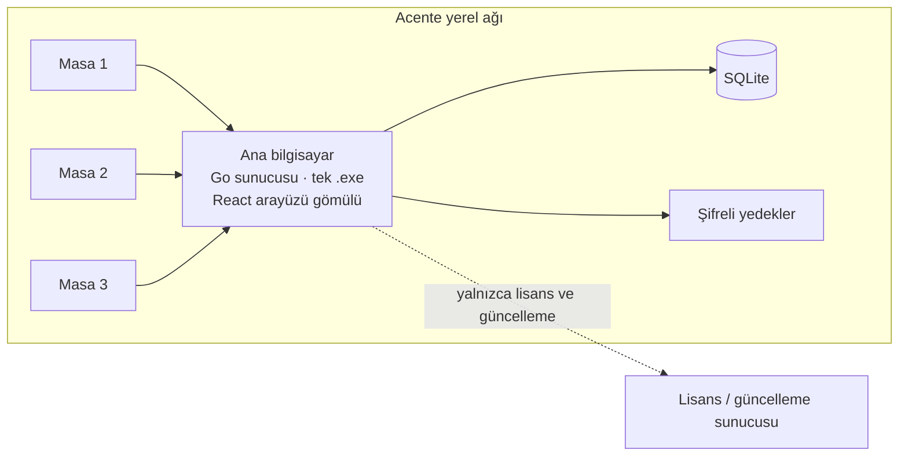

# SigortaTakip

**Bir sigorta acentesinin Excel ile tuttuğu poliçe takibinin yerine geçen, tamamen yerel ağda çalışan program.**

> Müşteriye özel bir iş olduğu için kaynak kodu gizli. Bu repo, sorunu ve nasıl çözdüğümü anlatır.

---

## Sorun

Acente yıllardır müşteri ve poliçe bilgilerini tek bir Excel dosyasında tutuyordu. Üç masa aynı dosyaya erişmeye çalışıyor, formüller bozuluyor, iptal ve iade hesapları elle yapılıyor, yedek alınmıyordu. Üstelik müşteri verisi kişisel veri: bulut bir sisteme taşımak istemiyorlardı.

## Çözüm

Acentenin kendi bilgisayarında arka planda çalışan bir sunucu ve masalardan kısayolla açılan bir arayüz. **Müşteri ve poliçe verisi hiçbir koşulda internete çıkmıyor.**

- Ana bilgisayarda tek bir `.exe`: sunucu, veritabanı ve arayüz içinde gömülü
- Masalarda hiçbir kurulum yok; kısayola tıklayınca adres çubuğu olmayan bir pencere açılıyor
- Sistem tepsisi ikonu ve bilgisayar açılınca otomatik başlama

## Özellikler

- Müşteri ve poliçe yönetimi, isteğe bağlı müşteri fotoğrafı
- Eski Excel dosyasından tek seferde içe aktarma
- İptal / iade süreci ve hesapları
- Kullanıcı bazlı yetkilendirme
- Otomatik yedekleme ve dışa aktarma
- Lisans doğrulama ve otomatik güncelleme
- Programın içinden istek / hata bildirimi (müşteri verisi içermeden)
- Sürüm notları ekranı

## Mimari

## Teknoloji

| Katman | Kullanılan |
|---|---|
| Sunucu | Go (tek binary, gömülü web arayüzü) |
| Veritabanı | SQLite, sürümlü migration'lar |
| Arayüz | React + TypeScript, Material 3 tabanlı tasarım sistemi |
| Masaüstü | Windows servisi + sistem tepsisi |

## Nasıl geliştirdim

İşe kod yazarak değil, mevcut Excel'in tam envanterini çıkarıp kırılgan noktaları listeleyerek başladım. Veritabanı şemasını, ekranları, iptal/iade mantığını ve yetki tablosunu bir tasarım dosyasında netleştirdim. Sonra her biri ayrı test raporuyla kapanan fazlarla ilerledim.

- ~325 Go dosyası, ~150 arayüz dosyası
- Şu an sürüm 1.5

---

[bycan.dev](https://bycan.dev) · [@bycandev](https://instagram.com/bycandev) · [Tüm projelerim](https://github.com/bycandev)
